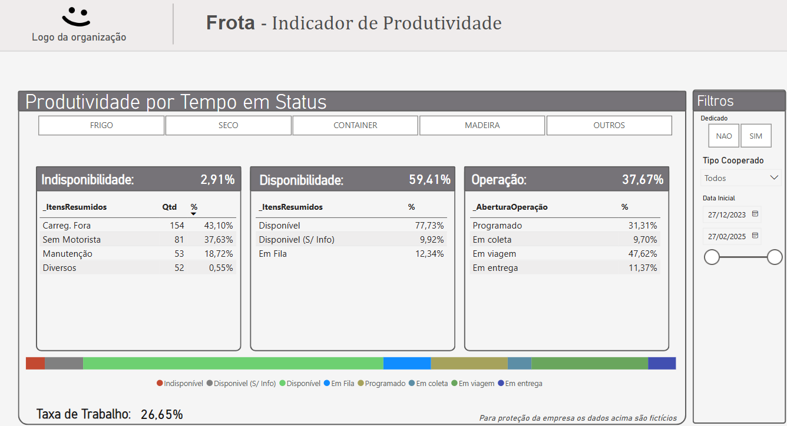
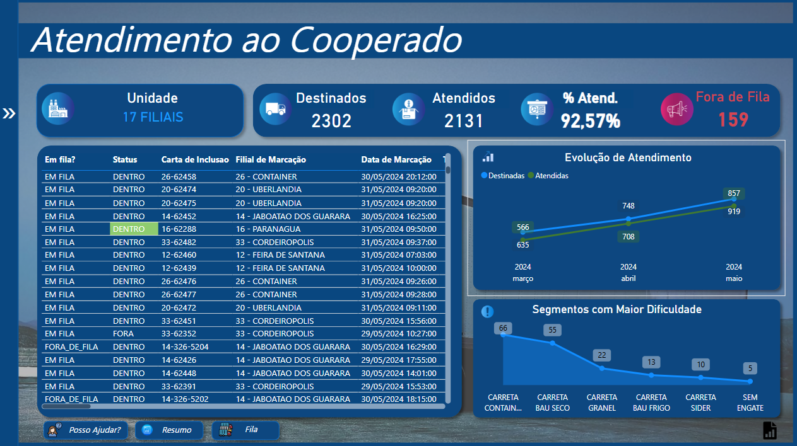
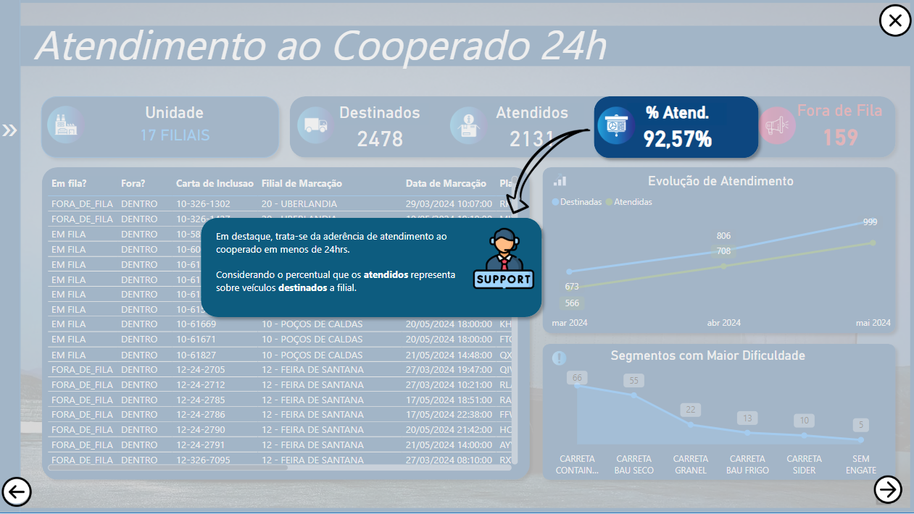
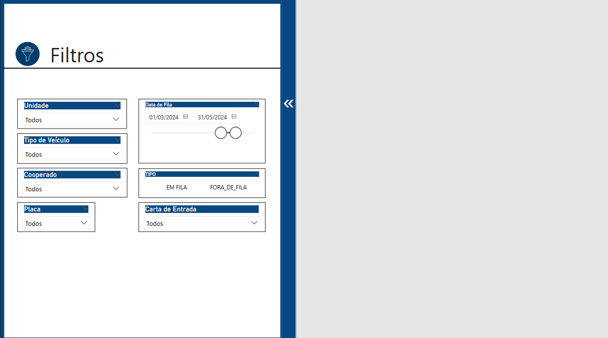

  

## Olá, sou o Gabriel Belo

**Analista de Dados & Desenvolvedor** · Itajaí, SC

Há mais de 9 anos transformo dados da operação logística em decisão — do banco de dados e dos pipelines até as aplicações e integrações que entregam essa informação para o negócio. Trabalho na maior cooperativa de transporte rodoviário de cargas do Brasil, pós-graduado em Logística e pós-graduando em Ciência de Dados.

- **SQL e bancos de dados** — SQL Server, PostgreSQL, MySQL; tuning de consultas, modelagem dimensional
- **BI & Analytics** — Power BI (DAX, Power Query/M), dashboards operacionais e gerenciais
- **Engenharia de dados** — data lake na AWS (S3, Glue, PySpark, Athena), arquitetura Medallion, Airflow
- **Desenvolvimento** — Node.js, TypeScript, React, Python, APIs REST/SOAP, Docker, testes, CI/CD
- **Integrações** — EDI, documentos fiscais (CT-e / NF-e), APIs de parceiros logísticos
- **IA aplicada** — IA generativa no desenvolvimento e em pipelines de análise

---

### Stack

---

### Cases técnicos

Repositórios escritos do zero, com **dados fictícios**, que reproduzem padrões que uso no dia a dia — nenhum código ou dado de empresa.

| Case | O que mostra | Stack |
|---|---|---|
| [**data-lake-medallion-aws**](https://github.com/GabBelo/data-lake-medallion-aws) | Pipeline Bronze → Silver → Gold de entregas logísticas, com testes e views para o Athena | PySpark · AWS Glue · S3 · Athena · pytest |
| [**sql-performance-cases**](https://github.com/GabBelo/sql-performance-cases) | Consultas lentas reescritas: SARGability, tabelas temporárias, window functions, índices de cobertura | PostgreSQL · SQL Server · Docker |
| [**api-entregas-typescript**](https://github.com/GabBelo/api-entregas-typescript) | API de entregas com DDD, contrato único em Zod, OpenAPI e testes automatizados | Bun · Elysia · TypeScript · Zod · Docker |
| [**torre-de-controle-frota**](https://github.com/GabBelo/torre-de-controle-frota) | Painel de frota em tempo real: geofence de CD e lojas, alertas de pátio, cache aquecido em segundo plano e métricas de tempo | Node.js · Express · JavaScript · node:test |

---

### Dashboards em Power BI

<b>Indicador de Produtividade da Frota</b> — disponibilidade, operação e taxa de trabalho

 

Visão da disponibilidade, indisponibilidade e operação da frota ao longo do tempo: motivos de indisponibilidade, veículos prontos (disponível, em fila), em operação (programado, coleta, viagem, entrega) e taxa de trabalho.

**Resultado:** aumento superior a 17% nos indicadores de desempenho da frota após a implantação.

  

<b>Atendimento ao Cooperado</b> — fluxo de veículos para carregamento nas filiais

 

Indicadores de atendimento dentro do prazo, veículos atendidos e fora da fila, tendência mensal, gestão da fila e segmentos com mais dificuldade — com filtros retráteis e ajuda para novos usuários.

**Resultado:** crescimento de aproximadamente 34% no atendimento nos três primeiros meses.

  

  
  

---

### Contato

